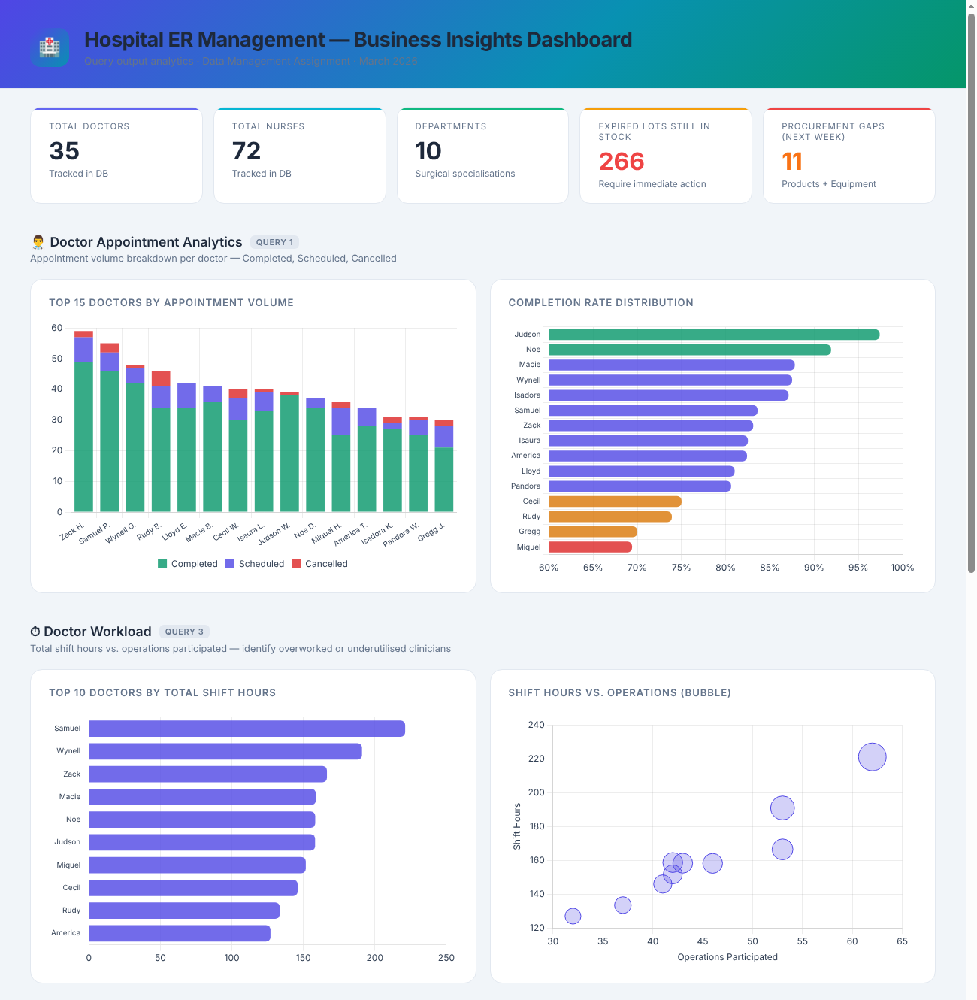
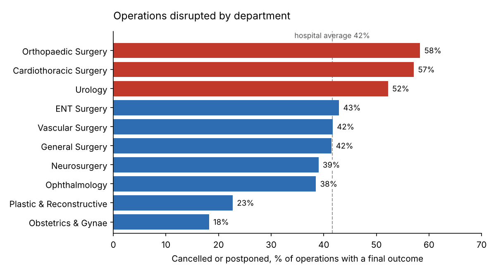

# Hospital Resource Management Database

**A 19-table relational database for a surgical centre, with 13 SQL queries that answer operational questions.** The queries show that **42% of operations with a final outcome were cancelled or postponed**, rising to 58% in Orthopaedics. They also find **266 expired stock lots (17,372 units, about a third of all stock) still on the shelves**, and pinpoint which bookings for next week are short of supplies.



## Business problem

US Med Center is a fictional multi-specialty surgical centre with 20 operating rooms, 10 surgical departments and 107 clinical staff. It struggles to coordinate rooms, staff, equipment and medical supplies across its scheduled operations, which leads to cancellations, double-booking, staff overload and stock shortages.

The database brings all of this into one normalised structure so management can answer questions such as:
- How often are operations cancelled or postponed, and in which departments?
- Which doctors and nurses carry the heaviest workload?
- Is there enough equipment for the busiest days?
- Which stock is expired or about to expire, and which upcoming operations are short of supplies?

## Database design

**19 tables, normalised to third normal form (3NF)**, with primary keys, foreign keys, `UNIQUE` and `CHECK` constraints. The full diagram is in [`docs/er_diagram.pdf`](docs/er_diagram.pdf).

| Layer | Tables |
|---|---|
| Master data | `Doctors`, `Nurses`, `Patients`, `Departments`, `OperationRooms`, `MedicalProductCatalog`, `MedicalEquipmentCatalog` |
| Operations | `Appointments`, `OperationScheduling` (central table), `DoctorShifts`, `NurseShifts` |
| Many-to-many links | `DoctorDepartment`, `NurseDepartment`, `DoctorScheduledOperations`, `NurseScheduledOperations` |
| Inventory & bookings | `ProductInventory` (tracked by lot and expiry), `EquipmentInventory`, `OperationProductBooking`, `OperationEquipmentBooking` |

Business rules enforced in the schema or the data include:
- Every operation ends after it starts.
- Allocated quantities can't exceed reserved quantities.
- Each product lot is unique, so stock can be traced to the lot.
- No room, doctor or nurse is double-booked. All three are checked automatically when the database is built.

## Data

- **About 11,700 rows of synthetic data.** Names come from the SMART Health IT FHIR API, and real drug and device names from the openFDA API.
- **Size:** 500 patients, 1,000 appointments, 500 operations, 3,256 staff shifts and 2,460 supply bookings.
- **Integrity checks on build:** 0 foreign-key violations, 0 room double-bookings, 0 doctor double-bookings.

## Results

All results below use a reference date of **25 March 2026**, the date the analysis was originally run.

**1. Cancellations and postponements are high, and concentrated in a few departments.** Of the 279 operations with a final outcome (completed, cancelled or postponed), 22.6% were cancelled and a further 19% postponed.



**2. Workload is uneven.** The busiest doctor worked 221 shift hours across 62 operations, more than double the median of 105 hours. The five busiest doctors handle 26% of all operation assignments.

**3. Expired stock isn't being cleared.** 266 lots (17,372 units, 34% of all units) are past their expiry date but still recorded as stock. A further 12 lots expire within 90 days. The inventory process needs a regular write-off step.

**4. Supply gaps for next week are visible in advance.** Four operations in the following 7 days have bookings that aren't fully allocated: 8 product lines and 3 equipment items. Operation OS-00110 alone is short on 5 products.

**5. Two equipment items hit 100% of stock on their busiest day.** Only two units each are held, so one more booking that day would cause a shortage.

## SQL highlights

Queries are in [`sql/02_business_queries.sql`](sql/02_business_queries.sql). They demonstrate:
- **Multi-table joins** (up to 5 tables) and conditional aggregation, such as `SUM(status = 'Cancelled')`
- **CTEs and window functions:** a rolling 3-month average and month-on-month change in product demand (`q08`)
- **Time-overlap logic** for booking conflicts: `new_start < existing_end AND new_end > existing_start` (`q12`)
- **Anti-joins** with `NOT EXISTS`, to find operating rooms free on a given date (`q11`)
- **Date arithmetic** to put stock into expiry risk bands (`q06`)

### Fixes made during review

- **Workload hours (`q03`, `q04`).** The original queries joined shifts and operations to each person at the same time, so every shift was counted once per operation. That inflated hours by up to 62× (13,717 hours instead of 221). Shifts and operations are now totalled separately before joining.
- **Equipment demand (`q13`).** The original query compared a whole year of bookings with stock, but equipment is reused between operations. It now compares stock with the peak number of units booked on a single day.

## How to run

```bash
pip install pandas
python build_database.py
```

This creates `hospital.db` (SQLite) from the CSVs in `data/`, runs the integrity checks, and saves every query result to `outputs/`. Open [`dashboard/dashboard.html`](dashboard/dashboard.html) in a browser for the interactive charts.

The team's original version ran on **AWS RDS (MySQL 8)**. Those files are kept in [`mysql_version/`](mysql_version/): the table creation and loading scripts and the MySQL queries, with the same fixes applied. To use them, copy `.env.example` to `.env` and fill in your own database details. The loading notebook expects the original CSV names in a `hospital_data/` folder, so copy the files from `data/` there first.

## My role

This was a group project for *Data Management* on the MSc Business Analytics at Warwick Business School (2026). **I contributed to the SQL business queries and built the insights dashboard** (Chart.js), which turns the query results into charts for managers. The database design, synthetic data generation and loading pipeline were team efforts.

## Repository structure

```
├── build_database.py           # builds hospital.db, runs checks and all queries
├── sql/
│   ├── 01_schema.sql           # SQLite schema (19 tables, constraints, indexes)
│   └── 02_business_queries.sql # 13 business queries
├── data/                       # synthetic CSV data (19 tables)
├── outputs/                    # query results (CSV)
├── dashboard/dashboard.html    # interactive Chart.js dashboard
├── docs/er_diagram.pdf         # full entity-relationship diagram
├── images/                     # README charts
└── mysql_version/              # original AWS RDS / MySQL implementation
```

## Tools

SQL (SQLite, MySQL 8) · Python (pandas, PyMySQL) · AWS RDS · Chart.js · ER modelling · Normalisation (3NF)
